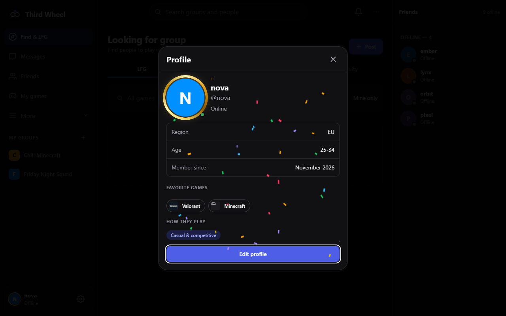
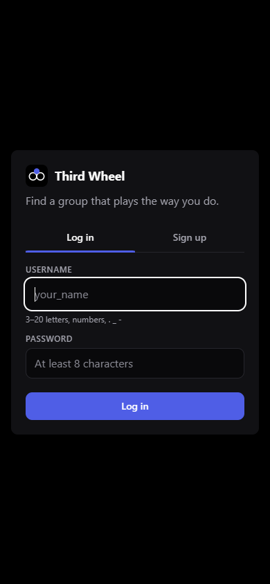

# Third Wheel

**Find groups of people who share your games.** Search by game, casual or competitive, region and age range; join group chats and voice chat; invite friends into your groups.


**Contents**
[Screenshots](#screenshots) · [Features](#features) · [How it is built](#how-it-is-built) · [Code breakdown](#code-breakdown) · [Database](#database) · [Getting started](#getting-started) · [Hosting](#hosting) · [Security](#security) · [Repository layout](#repository-layout)

---

## Screenshots

### Desktop

| Group chat, voice and auto-translate | Profile with an effect and a frame |
|---|---|
|  |  |

| Settings | Log in |
|---|---|
|  |  |

### Phone

| Log in | Find groups | Settings |
|---|---|---|
|  |  |  |

The screenshots come from a demo instance with made-up users.

---

## Features

**Find people**
- Groups with game, casual or competitive, region and age range; friends and direct messages.
- LFG board ("looking for group"), recommendations, play sessions and "good teammate" ratings.

**Talk**
- Chat with files, GIFs, voice messages, pinned messages, search and read receipts.
- Group voice chat and friend calls (peer-to-peer WebRTC), screen sharing.
- English, Swedish, German, Spanish and Finnish, plus per-chat auto-translate for mixed-language groups.

**Accounts**
- Sign up with a password (email confirmed with a link, password reset by email) or with Google / Discord.
- Verified Steam and Discord accounts on a profile.

**Profile**
- 17 animated avatar frames and 15 animated profile effects (RCKT perks), customisable section layout.
- Gaming clips on the profile.

**Desktop app**
- Clip catcher: records only while a game is running, F8 keeps the last 30 seconds, then trim and post to a group or your profile.
- Global mute / deafen hotkeys, game detection, tray icon, notifications.

**Phone**
- Installable web app (PWA). Below 900px the layout switches to a mobile layout with a bottom bar.

---

## How it is built

| Part | Tech | Where |
|---|---|---|
| Server | C# / ASP.NET Core (.NET 10, minimal API), SQLite, WebSocket for live updates | `server/` |
| Web UI | Vanilla HTML / CSS / JavaScript, no framework, flat colours | `server/wwwroot/` |
| Desktop app | Python + PySide6 (Qt WebEngine), packaged with PyInstaller | `desktop/` |
| Deploy | PowerShell scripts, Windows service, Caddy for HTTPS | `deploy/` |

---

## Code breakdown


| Language | Share | Lines | Files |
|---|---:|---:|---:|
| JavaScript | 53.7% | 9,742 | 20 |
| C# | 29.6% | 5,375 | 20 |
| CSS | 9.5% | 1,730 | 12 |
| Python | 4.8% | 866 | 2 |
| PowerShell | 2.1% | 379 | 6 |
| HTML | 0.3% | 51 | 1 |

Non-empty lines in git-tracked source files. Regenerate with `node docs/make-stats.mjs`.

---

## Database

SQLite, a single file (`tw.db`). The server creates and migrates the tables itself on start, so there is nothing to set up.

| File | What it is |
|---|---|
| [`docs/database/schema.sql`](docs/database/schema.sql) | All 43 tables and indexes. |
| [`docs/database/third-wheel-demo.db`](docs/database/third-wheel-demo.db) | A demo database with five made-up users, three groups, chat messages and friendships. Open it with any SQLite tool (for example *DB Browser for SQLite*), or run the server on it by renaming it to `tw.db` in the folder `TW_DATA` points at. |

The database of the live server is **not** in this repository. It holds real people's data (password hashes, emails, IP addresses, private messages) and this repository is public.

---

## Getting started

### Run from source

Needs the .NET 10 SDK.

```powershell
cd server
dotnet run --no-launch-profile   # http://127.0.0.1:5173
```

The app starts empty: no accounts, groups or friends. Sign up to create the first account.
Data lives in `%LOCALAPPDATA%\ThirdWheel\tw.db` (delete it to reset).

### Build the desktop app

Needs the .NET 10 SDK and Python 3.12+.

```powershell
.\build.ps1
```

Output: `dist\ThirdWheel\ThirdWheel.exe` (keep the `_internal` folder beside it).

### Phone

Open the hosted site in the phone browser and use "Add to Home Screen". The server only listens on `127.0.0.1` by default, so a phone can't reach a local copy.

---

## Hosting

`deploy/sync.ps1` builds the server, uploads it to a Windows server over SSH and restarts it (details in `deploy/README.md`).

Optional settings go in `deploy/server-secrets.env`, started from `deploy/server-secrets.example.env`:

- Google and Discord sign-in
- Email through any SMTP account (confirmation links and password reset)
- TURN relay for voice

Secrets never go in git.

---

## Security

- PBKDF2 password hashing, HttpOnly SameSite=Strict session cookie.
- `X-TW` header required on every write (CSRF), parameterized SQL, user text HTML-encoded on the server and rendered with `textContent`.
- CSP and other security headers.
- Rate limits on login, sign-up, uploads, translation and password reset.
- Password reset links are one-time, expire after an hour, and only go to a confirmed email address.

---

## Repository layout

```
server/            ASP.NET Core server and the web UI (wwwroot/)
desktop/           Python desktop app
deploy/            Hosting scripts and settings templates
docs/              Screenshots, language chart, database schema and demo database
build.ps1          Builds the desktop app
```
