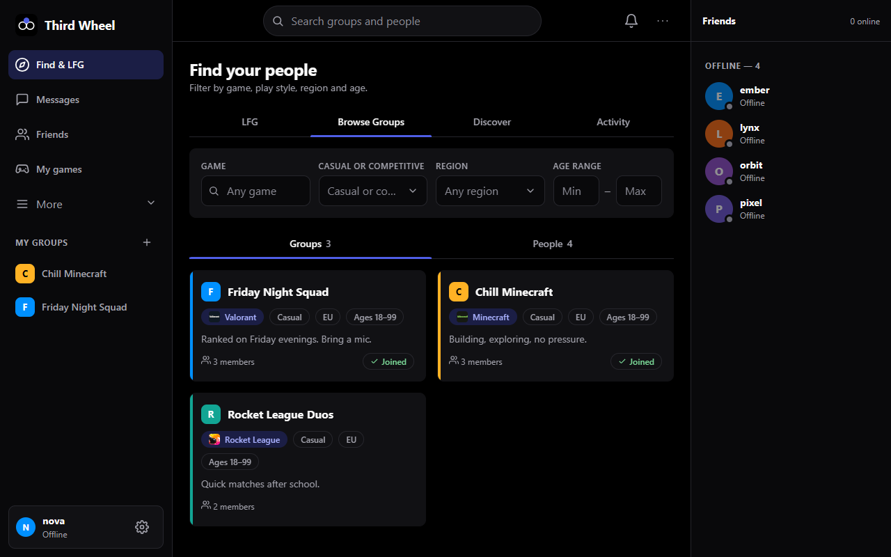
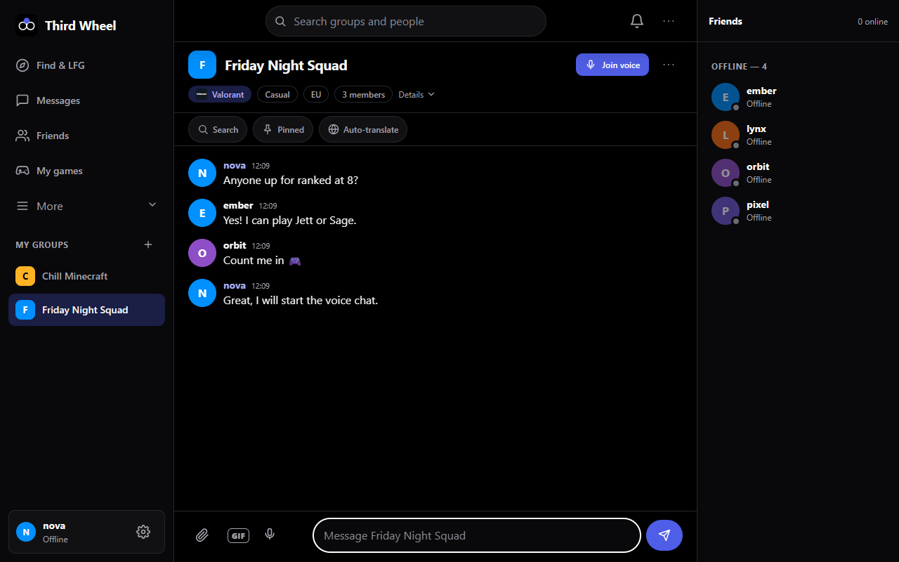
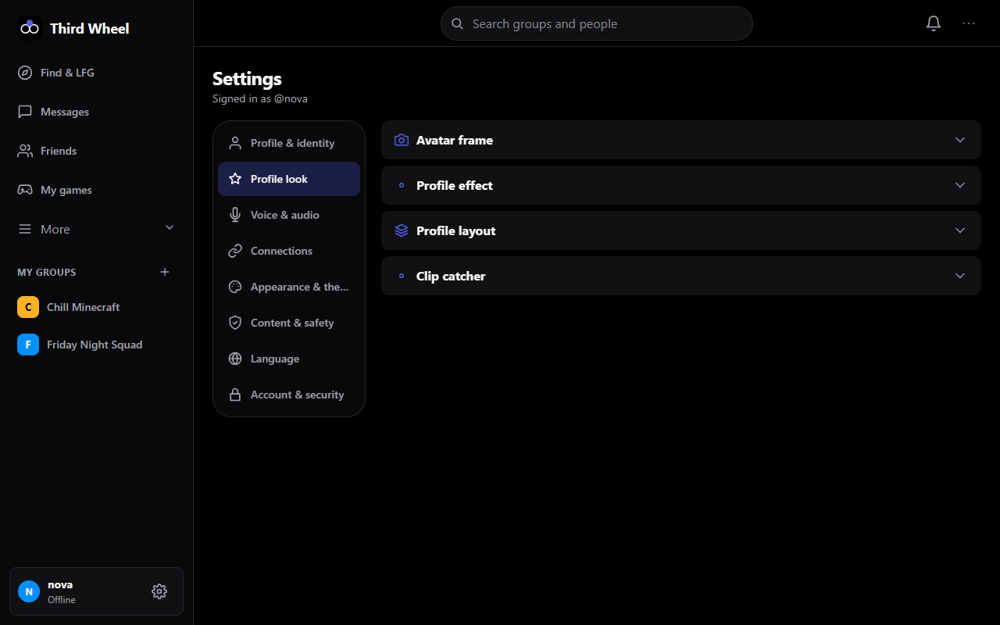
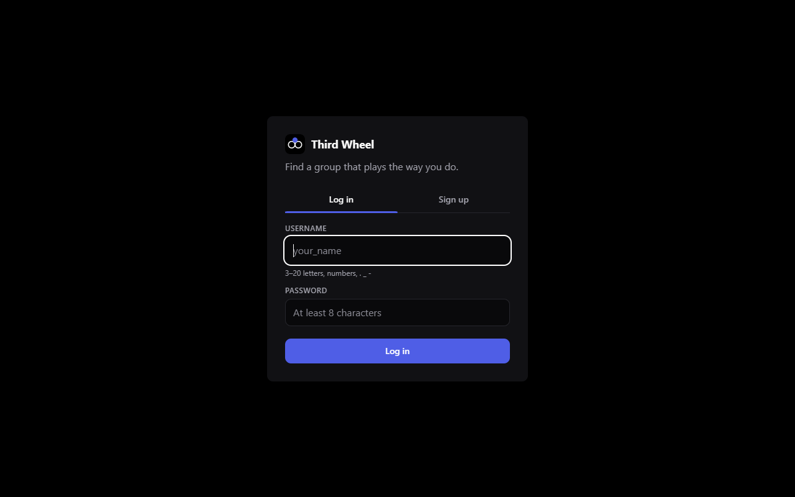
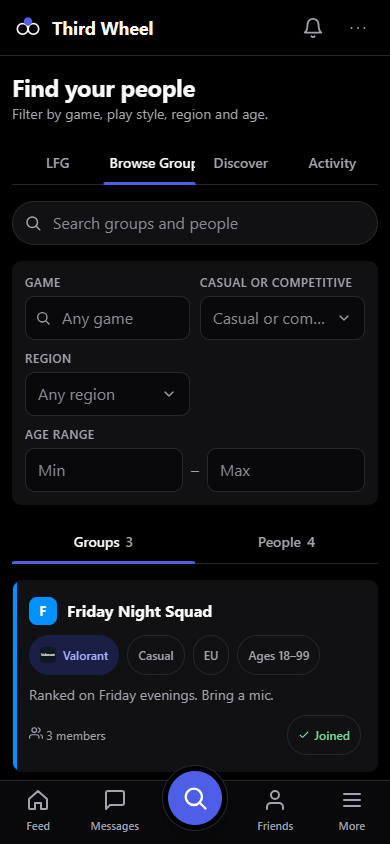
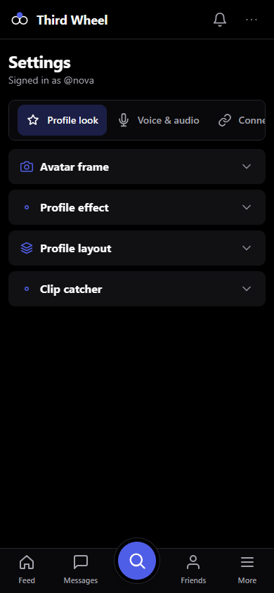
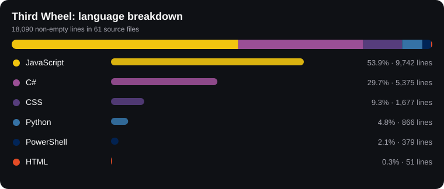

# Third Wheel

Find groups of people who share your games. Search by game, casual or competitive, region and age range; join group chats and voice chat; invite friends into your groups.



## Screenshots

| Group chat with voice and auto-translate | Settings |
|---|---|
|  |  |

| Log in | Phone: find | Phone: settings |
|---|---|---|
|  |  |  |

The screenshots show a demo instance with made-up users.

## What it does

- Groups, friends and direct messages, with files, GIFs, voice messages, pinned messages, search and read receipts.
- Group voice chat and friend calls (peer-to-peer WebRTC), screen sharing.
- LFG board ("looking for group"), recommendations, play sessions and "good teammate" ratings.
- Sign up with a password (email confirmed with a link, password reset by email) or with Google / Discord.
- Profile: avatar frames, 15 animated profile effects, section layout, gaming clips, verified Steam / Discord accounts.
- Clip catcher in the desktop app: records only while a game runs, F8 keeps the last 30 seconds, trim and post to a group or your profile.
- English, Swedish, German, Spanish and Finnish. Per-chat auto-translate for mixed-language groups.
- Installable web app (PWA) for phones; below 900px the layout switches to a mobile layout.

## How it is built

- **Server:** C# / ASP.NET Core (.NET 10, minimal API) + SQLite, in `server/`. Serves the API, a WebSocket for live updates, and the web UI.
- **Web UI:** vanilla HTML / CSS / JavaScript in `server/wwwroot/` (no framework, flat colours, tokenized CSS).
- **Desktop app:** Python + PySide6 (Qt WebEngine) in `desktop/`, packaged to `ThirdWheel.exe` with PyInstaller.
- **Deploy scripts:** PowerShell in `deploy/` (Windows service, Caddy for HTTPS).

### Code breakdown



| Language | Share | Lines | Files |
|---|---:|---:|---:|
| JavaScript | 53.9% | 9,742 | 20 |
| C# | 29.7% | 5,375 | 20 |
| CSS | 9.3% | 1,677 | 12 |
| Python | 4.8% | 866 | 2 |
| PowerShell | 2.1% | 379 | 6 |
| HTML | 0.3% | 51 | 1 |

Non-empty lines in git-tracked source files. Regenerate with `node docs/make-stats.mjs`.

## Database

SQLite, one file (`tw.db`). The server creates and migrates the tables itself on start, so there is nothing to set up.

- [`docs/database/schema.sql`](docs/database/schema.sql): all 43 tables and indexes.
- [`docs/database/third-wheel-demo.db`](docs/database/third-wheel-demo.db): a demo database with five made-up users, three groups, chat messages and friendships. Open it with any SQLite tool (for example *DB Browser for SQLite*), or run the server on it by pointing `TW_DATA` at a folder containing it renamed to `tw.db`.

The database of the live server is **not** in this repository: it holds real people's data (password hashes, emails, IP addresses and private messages) and this repository is public.

## Build the desktop exe

Needs .NET 10 SDK and Python 3.12+.

```powershell
.\build.ps1
```

Output: `dist\ThirdWheel\ThirdWheel.exe` (keep the `_internal` and `server` folders beside it).

## Run from source

```powershell
cd server
dotnet run --no-launch-profile   # http://127.0.0.1:5173
```

The app starts empty: no pre-made accounts, groups or friends. Sign up to create the first account.
Data lives in `%LOCALAPPDATA%\ThirdWheel\tw.db` (delete it to reset).

## Hosting it

`deploy/sync.ps1` builds the server, uploads it to a Windows server over SSH and restarts it (see `deploy/README.md`). Optional settings (Google / Discord sign-in, email through SMTP, TURN relay) go in `deploy/server-secrets.env`; start from `deploy/server-secrets.example.env`. Secrets never go in git.

## Security

PBKDF2 password hashing, HttpOnly SameSite=Strict session cookie, `X-TW` header required on all writes (CSRF), parameterized SQL, all user text HTML-encoded on the server and rendered with `textContent` in the UI, CSP and other security headers, rate limiting on login, sign-up, uploads, translation and password reset. Password reset links are one-time, expire after an hour, and only go to a confirmed email address.
